# Mechanical Engineering Project Group ไอเอิท

## Delta Haptic Device

- **Team:** 6730156021 Natchakrit Thongraya, 6730317821 Piyathon Banjong, 6730154821 Natthabhat Nilsuwan
- **Purpose:** a low-cost 3-DOF haptic interface. The user holds a handle that moves in 3D; the device can read its
  position and push back with a force. It is a delta (parallel) mechanism with three NEMA17 motors, each driving its
  arm through a rope capstan, built from 3D-printed PETG parts.
- **Status:** unit assembled; CAD final; Simscape Multibody model, symbolic kinematics/dynamics and circle-motion
  animation done.

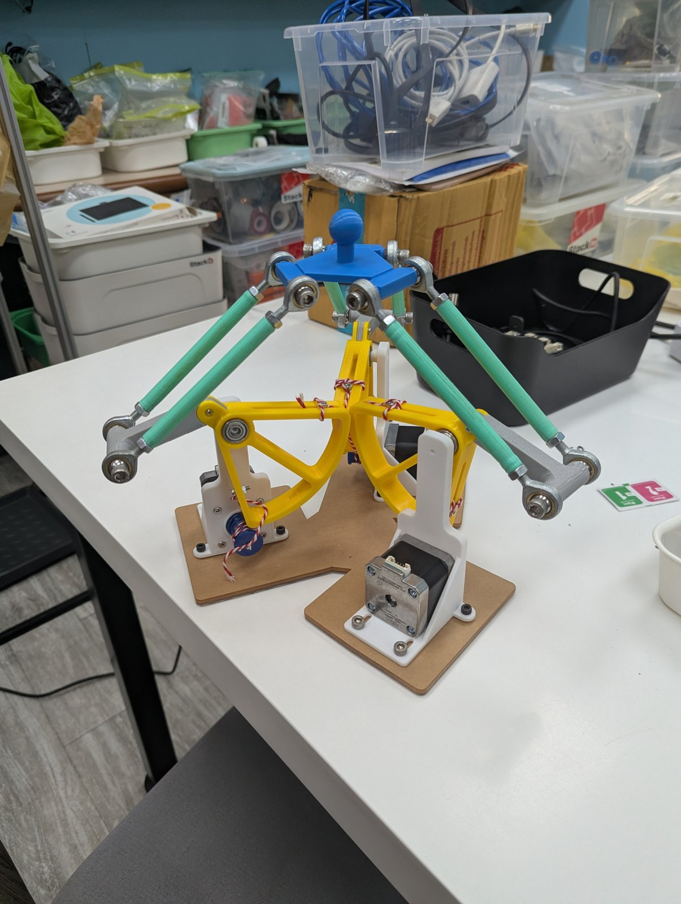 <a href="media/final_unit_demo.mp4">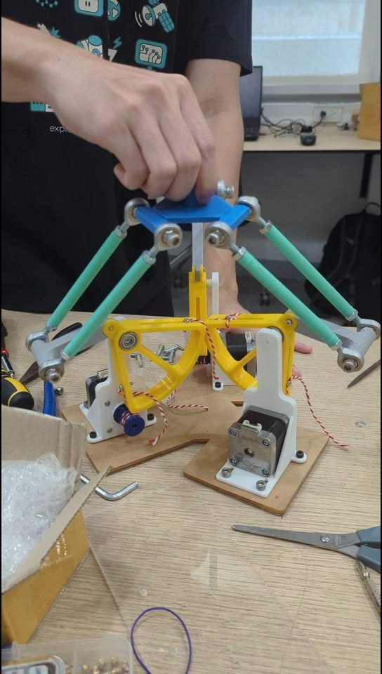</a> 

Left: the final unit. Middle: [video](media/final_unit_demo.mp4) of the handle moved by hand (18.5 s). Right: the
symbolic animation moving the hand round a circle.

**Contents:** [1. How the delta works](#1-how-the-delta-works) ·
[2. DOF analysis](#2-dof-analysis) · [3. Circle motion](#3-circle-motion) ·
[4. Running the simulation](#4-running-the-simulation) · [5. Hardware](#5-hardware) ·
[6. Assumptions](#6-assumptions) · [7. Detailed walk-through](#7-detailed-walk-through) · [8. Media](#8-media)

---

## 1. How the delta works

### 1.1 The mechanism

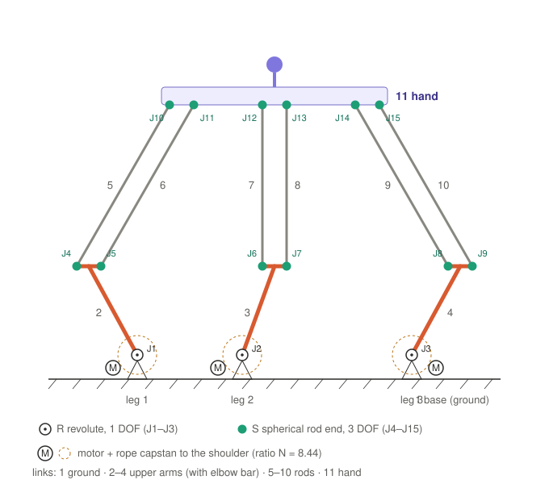

Three identical legs stand on the base, 120° apart (at 180°, 300° and 60°). Each leg is a chain:

**motor → rope capstan → upper arm (turns about the shoulder) → two parallel rods → hand**

- The **motor** turns a small drum (rope groove r = 9 mm). A rope wrapped round it drives the **big drum** (r = 76 mm),
  which is part of the upper arm. Ratio **N = 76/9 ≈ 8.44**: the arm turns 8.44× slower than the motor with 8.44×
  the torque, in the opposite direction, with no gears and no backlash. The rope wrap limits the arm to
  **−85.0° … −2.8°** (arm up).
- The **upper arm** (La = 72.1 mm) can only rotate about its shoulder axis (two 606ZZ bearings).
- The **two forearm rods** (Lb = 170 mm, 47 mm apart) have an M6 rod end (a ball joint) at each end. Being equal and
  parallel, they form a **parallelogram**, so the hand edge always stays parallel to the elbow bar.
- The **hand** joins all three legs. Because each leg's parallelogram keeps the hand parallel to a different
  direction, the hand **cannot rotate**: it only translates in x, y, z. Three motor angles give one hand position.

### 1.2 One leg in numbers

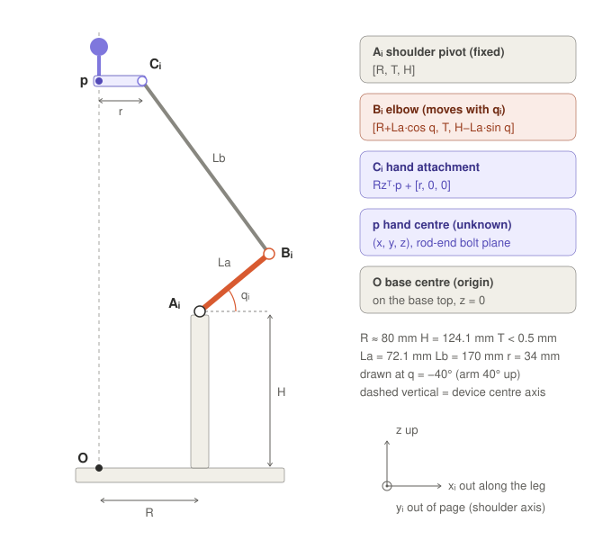

Each leg is written in its own frame (x out along the leg, z up):

| Point | Expression | Meaning |
|---|---|---|
| Aᵢ | [R, T, H] | shoulder pivot, fixed |
| Bᵢ | [R + La·cos qᵢ, T, H − La·sin qᵢ] | elbow, turns with the shoulder angle qᵢ (q > 0 = arm down) |
| Cᵢ | Rzᵀ·p + [r, 0, 0] | where the rods meet the hand; p = (x, y, z) is the hand centre |

| Symbol | Value | Meaning |
|---|---|---|
| R | 80.95 / 79.55 / 78.83 mm | base centre → shoulder, per leg (from the base screw holes) |
| H | 124.1 mm | shoulder height above the base top |
| T | < 0.5 mm | small sideways offset along the shoulder axis |
| La | 72.1 mm | upper arm, shoulder → elbow |
| Lb | 170 mm | forearm rod, eye to eye |
| r | 34 mm | hand centre → hand rod-end bolt line |
| w | 47 mm | spacing of the two rods |
| N | 76/9 ≈ 8.44 | capstan ratio |

### 1.3 The one equation: rods cannot stretch

The parallelogram behaves like a single rod from Bᵢ to Cᵢ, so each leg has exactly one constraint:

$$|C_i - B_i| = L_b$$

With d = Cᵢ − Aᵢ (shoulder → hand attachment) this expands to

$$a\cos q_i + b\sin q_i + c = 0,\qquad a = -2L_a d_x,\quad b = 2L_a d_z,\quad c = |d|^2 + L_a^2 - L_b^2$$

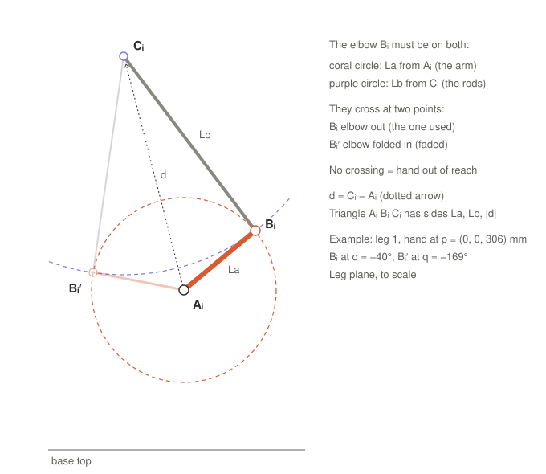

Geometrically the elbow must lie on a circle of radius La round the shoulder **and** on a circle of radius Lb round
the hand attachment. With the half-angle substitution u = tan(q/2) the equation becomes a quadratic, giving the
**inverse kinematics** (hand position → arm angles):

$$q_i = 2\arctan\!\left(\frac{b \pm \sqrt{a^2+b^2-c^2}}{a-c}\right)$$

Two solutions (elbow out, used; elbow folded in, impossible here). When a² + b² − c² < 0 the circles do not meet: the
hand is out of reach, which is the edge of the workspace.

### 1.4 Speed and force: the Jacobian

Differentiating the constraint gives the hand–arm speed relation, the **Jacobian** J:

$$\Phi_p\,\dot p + \Phi_q\,\dot q = 0 \quad\Rightarrow\quad \dot p = J\,\dot q,\qquad J = -\Phi_p^{-1}\Phi_q$$

Physically: a rod cannot stretch, so both of its ends move at the same speed along it. At the home pose (all arms
40° up) the rods are almost exactly at 90° to the arms (best transmission): 1° on every arm lifts the hand 1.57 mm,
1° at a motor moves it about 0.19 mm.

The same J maps forces backwards: a hand force F needs shoulder torques τ = Jᵀ·F, and motor torques
τ_m = −τ/N. Holding the whole device still against gravity takes only **≈ 10.7 mN·m per motor**.

---

## 2. DOF analysis

### 2.1 Links

| # | Link | Count | Moves? |
|---|---|---|---|
| 1 | base: plate, brackets, motors (fixed together) | 1 | no, ground |
| 2–4 | upper arm: big drum, connector, elbow bar | 3 | yes |
| 5–10 | forearm rod: tube + two rod-end housings | 6 | yes |
| 11 | hand | 1 | yes |
| | **total n** | **11** | |

### 2.2 Joints

| Joint | Leg | Connects (link ↔ link) | Physical part | Type | f (DOF) | Removes (6 − f) |
|---|---|---|---|---|---|---|
| J1 | 1 | base (1) ↔ upper arm (2) | shoulder, 2 × 606ZZ | R revolute | 1 | 5 |
| J2 | 2 | base (1) ↔ upper arm (3) | shoulder, 2 × 606ZZ | R revolute | 1 | 5 |
| J3 | 3 | base (1) ↔ upper arm (4) | shoulder, 2 × 606ZZ | R revolute | 1 | 5 |
| J4 | 1 | upper arm (2) ↔ rod a (5) | elbow rod end | S spherical | 3 | 3 |
| J5 | 1 | upper arm (2) ↔ rod b (6) | elbow rod end | S spherical | 3 | 3 |
| J6 | 2 | upper arm (3) ↔ rod a (7) | elbow rod end | S spherical | 3 | 3 |
| J7 | 2 | upper arm (3) ↔ rod b (8) | elbow rod end | S spherical | 3 | 3 |
| J8 | 3 | upper arm (4) ↔ rod a (9) | elbow rod end | S spherical | 3 | 3 |
| J9 | 3 | upper arm (4) ↔ rod b (10) | elbow rod end | S spherical | 3 | 3 |
| J10 | 1 | rod a (5) ↔ hand (11) | hand rod end | S spherical | 3 | 3 |
| J11 | 1 | rod b (6) ↔ hand (11) | hand rod end | S spherical | 3 | 3 |
| J12 | 2 | rod a (7) ↔ hand (11) | hand rod end | S spherical | 3 | 3 |
| J13 | 2 | rod b (8) ↔ hand (11) | hand rod end | S spherical | 3 | 3 |
| J14 | 3 | rod a (9) ↔ hand (11) | hand rod end | S spherical | 3 | 3 |
| J15 | 3 | rod b (10) ↔ hand (11) | hand rod end | S spherical | 3 | 3 |
| **Total** | | | | **j = 15** | **Σf = 39** | **Σ = 51** |

R revolute: 1 rotation about the shoulder axis. S spherical (rod end): 3 rotations about the ball centre (within
±13° tilt), no translation.

### 2.3 Grübler–Kutzbach (spatial)

$$M = 6(n - 1 - j) + \sum_{i=1}^{j} f_i = 6(11 - 1 - 15) + 39 = -30 + 39 = \mathbf{9}$$

$$\sum f_i = \underbrace{1+1+1}_{J1\text{–}J3} + \underbrace{3\times 6}_{J4\text{–}J9} + \underbrace{3\times 6}_{J10\text{–}J15} = 39$$

| | Count | Meaning |
|---|---|---|
| idle DOF | 6 | each rod can spin about its own axis between its two balls; nothing else moves |
| useful DOF | 9 − 6 = **3** | hand translation x, y, z (orientation locked by the three parallelograms) |

**Drive chain:** each motor rotor adds a body and a revolute joint (+1) but its rope ties it to the arm (−1): no
change. **3 motors drive the 3 useful DOF**, so the device is fully actuated and not redundant.

**Simscape model:** it uses a universal joint (f = 2) at the elbows J4–J9, which removes the rod spins:
M = 6(11 − 1 − 15) + 3·1 + 6·2 + 6·3 = **3**.

---

## 3. Circle motion

### 3.1 Why the circle is about 30 mm

The arms alone could carry the hand round a circle of about 80 mm radius. The limit is the **rod ends**: an M6 rod
end tilts at most ≈ 13° out of its plane. Moving the hand sideways by p·vᵢ (vᵢ = shoulder-axis direction) tilts leg
i's rods by

$$\text{tilt}_i = \arcsin\frac{|p\cdot v_i - T_i|}{L_b}$$

which reaches 13° at a radius of about 37 mm. Both circle motions therefore use the largest circle that keeps every
arm inside its rope end-stops **and** every rod end below 13° (`maxRadius.m`, `rodEndTilt.m`), with a small margin.

### 3.2 Symbolic animation (`delta_symbolic_anim.m`)

The hand follows a horizontal circle, 2 laps of 5 s:

$$p(t) = \big[x_0 + R_c\cos\tfrac{2\pi t}{5},\ \ y_0 + R_c\sin\tfrac{2\pi t}{5},\ \ z_0\big],\qquad R_c = 30.7\text{ mm},\ z_0 = 313\text{ mm}$$

1. **Symbols and points** Aᵢ, Bᵢ(qᵢ), Cᵢ(p) (section 1.2).
2. **Solve** |Cᵢ − Bᵢ| = Lb for qᵢ(x, y, z) with `solve()` and u = tan(q/2) (section 1.3), keeping elbow out.
3. **Substitute** p(t): `q_t = subs(qIK, p, pt)`, then `diff(q_t, t)` and `diff(q_t, t, 2)` give arm speed and
   acceleration (the chain rule builds J automatically).
4. **Check** q(t) against the numeric inverse kinematics `deltaIK` (to 1e-9 rad), the rope end-stops and the
   rod-end tilt; the script stops with a message if any check fails.
5. **Animate** with `fanimator` / `playAnimation`: upper arms (red), rods (green), hand (blue), the circle path
   (magenta, centre marked +) and a magenta dot riding on the hand.

Result: arms between −59.5° and −31.2°, rod-end tilt at most 10.8°.

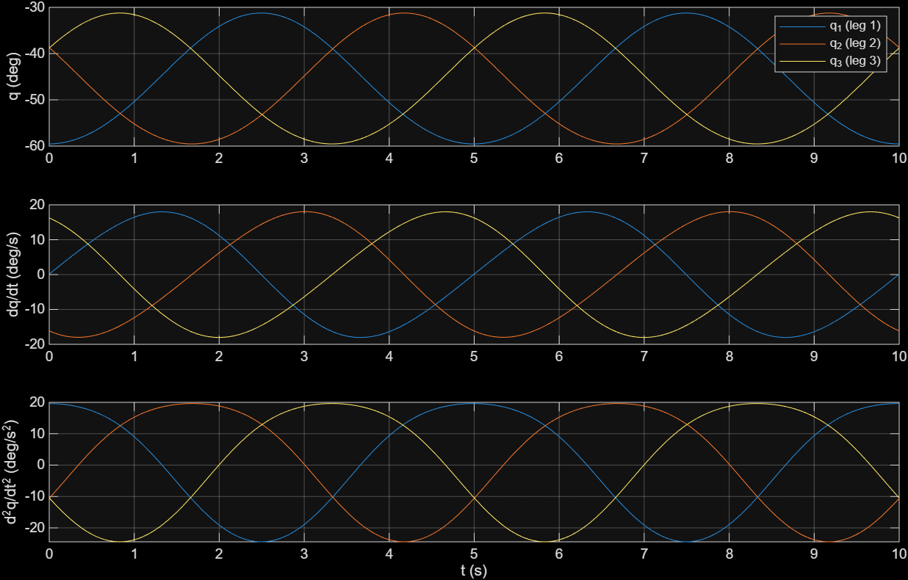

Each arm swings once per lap; the three legs are 120° out of phase, like the three phases of a motor.

### 3.3 Simscape Multibody circle (`circle_demo.m`)

The full multibody model (all CAD parts, weighed masses, rope capstans, end-stops) is driven by "grabbing" the top
of the handle: `run_grab_path.m` adds a 6-DOF joint whose x, y, z follow the path, so the motors are passive and the
arms, rods and drums follow as in the real unit when you move the handle by hand. The circle has a 3° margin from
the rope stops: **radius 28.3 mm, 3 laps, handle tracking error 0.07 mm, rod-end tilt ≤ 10°.**

---

## 4. Running the simulation

MATLAB R2026a with Simulink, Simscape, Simscape Multibody and Symbolic Math Toolbox. Open MATLAB in `simulation/`:

| Command | What it does |
|---|---|
| `build_delta_haptic` | builds the Simscape Multibody model `delta_haptic.slx` from the STEP files; all parameters `P.*` are at the top |
| `circle_demo` | moves the handle round the largest allowed circle, 3 laps, in the 3D view (`circle_demo(false)` without real-time pacing) |
| `delta_symbolic_anim` | symbolic inverse kinematics, speed and acceleration, plots and the circle animation |

| File | Purpose |
|---|---|
| `build_delta_haptic.m` | model builder and parameter set `P` (geometry, weighed masses, drive, limits, colours) |
| `circle_demo.m`, `run_grab_path.m` | circle demo on the Simscape model; adds the "grab" joint and drives it along the path |
| `delta_symbolic_anim.m`, `delta_symbolic.mat` | symbolic circle animation and the parameters it loads |
| `deltaFK.m`, `deltaIK.m` | numeric forward / inverse kinematics |
| `maxRadius.m`, `rodEndTilt.m` | largest allowed circle at a height; rod-end tilt per leg |

**Model structure:** top level Environment, Leg 1–3, Hand, MotorTorque. Each leg: motor + bracket → drive (motor
shaft, small drum, rope as a no-slip gear constraint) → upper arm (shoulder joint with rope end-stops, connector, big
drum, 2 × 606ZZ, rope anchors) → 2 forearm rods (universal joint at the elbow, ball joint at the hand). Part colours
match the built unit (`col.*` in `build_delta_haptic.m`). STEP files are read from `hardware/mechanical/cad/`;
generated `.slx` files are not stored, the scripts rebuild them.

**Verified during development:** forward kinematics vs Simscape 5e-13 mm; inverse kinematics round trip 1e-15 rad;
Jacobian, velocity and acceleration vs finite differences ≈ 1e-7; gravity compensation in Simscape 0.00 % residual;
free-fall start acceleration symbolic vs Simscape within 0.9 %; bracket vs base screw holes within 0.005 mm.

---

## 5. Hardware

STEP files in [`hardware/mechanical/cad/`](hardware/mechanical/cad/) (read directly by the model; keep the names).
All masses weighed.

| File | Part | Qty | Mass (each) |
|---|---|---|---|
| `Base V4.step` | base plate | 1 | 250 g |
| `Motor Bracket v6.STEP` | motor bracket + shoulder pivot (white PETG) | 3 | 32.2 g |
| `Big Drum V6.STEP` | big capstan drum sector r 76 mm, part of the upper arm (yellow PETG) | 3 | 31.3 g |
| `connector v6.STEP` | upper arm / elbow bar (grey PETG) | 3 | 9.1 g |
| `Small Drum v5.STEP` | small capstan drum on the motor shaft, r 9 mm (blue PETG) | 3 | 4.2 g |
| `Link V.2.step` | forearm tube Ø10 × 100 (mint PETG) | 6 | 6.8 g |
| `hand V.3.step` | hand with handle (blue PETG) | 1 | 12.9 g |
| `Nema17 42BYGH40.step` | NEMA17 stepper motor | 3 | 330 g |
| `M6 Rod End L51.step` (+ ball / housing) | M6 rod end, 51 mm stud | 12 | 20 g |
| `606ZZ.step` | bearing, 2 per big drum | 6 | 5.7 g |
| `M6x12 ISO4762.step` | rod-end screws | 12 | 6.3 g |
| `M3x6 ISO4762.step` | motor, bracket and drum-stub screws | 27 | 0.66 g |
| `M3x10 ISO4762.step`, `M3 nut ISO4032.step` | rope clamp in the big drum slot | 6 | 1.51 g per pair |

Electronics (bench test): 3 × TB6600 stepper drivers, ESP32-S3 controller.

---

## 6. Assumptions

1. **Rigid parts, ideal joints:** no flex in the printed parts, no play in bearings or rod ends.
2. **Parallel rods** stay parallel and equal, so the hand never tilts.
3. **Rope** does not slip or stretch (ratio exactly 76/9); end-stops modelled as stiff springs (2000 N·m/rad,
   2 N·m·s/rad).
4. **Rod-end tilt limit 13°** (typical M6 rod end); checked along the paths, not enforced by the joints.
5. **Masses:** every part uses its weighed mass spread over its CAD shape; rod-end balls at steel density; the
   M3×10 + nut pair split by the nut's ISO size; motor rotor 54 g·cm² (typical NEMA17).
6. **Friction:** only viscous shoulder damping 2 mN·m·s/rad (estimate); no bearing/rope friction, detent torque or
   backlash.
7. **Motors** are ideal torque sources (the TB6600 step/direction drivers cannot command torque; real force
   feedback needs torque-controlled drives and encoders).
8. **Sensing:** joint angles known exactly; no encoder resolution or control delay.
9. **Dynamics:** each arm one rigid body plus N² × rotor inertia; each rod's mass split half to elbow, half to hand.
10. **Gravity** 9.81 m/s² along −z; base level and fixed; collisions not modelled.

---

## 7. Detailed walk-through

Step-by-step derivations with diagrams and worked numbers, in [`docs/symbolic-math/`](docs/symbolic-math/):

| Part | Topic |
|---|---|
| [1](docs/symbolic-math/01-leg-points.md) | the points of one leg (side and top view) |
| [2](docs/symbolic-math/02-forearm-equation.md) | the forearm-length equation and the two-circle picture |
| [3](docs/symbolic-math/03-solving-for-q.md) | solving for q with u = tan(q/2) |
| [4](docs/symbolic-math/04-velocity-jacobian.md) | velocity and the Jacobian |
| [5](docs/symbolic-math/05-acceleration.md) | acceleration |
| [6](docs/symbolic-math/06-dynamics.md) | dynamics: motor torque to hand force |
| [7](docs/symbolic-math/07-animation-script.md) | how the circle animation script works |
| [8](docs/symbolic-math/08-dof-analysis.md) | degrees of freedom and kinematic diagram |

Scripts named there but not in this repository (`delta_symbolic.m`, `delta_kinematics*.m`, `delta_dynamics.m`,
`delta_motor_torque.m`) were used to derive and verify the results.

---

## 8. Media

**Final unit**

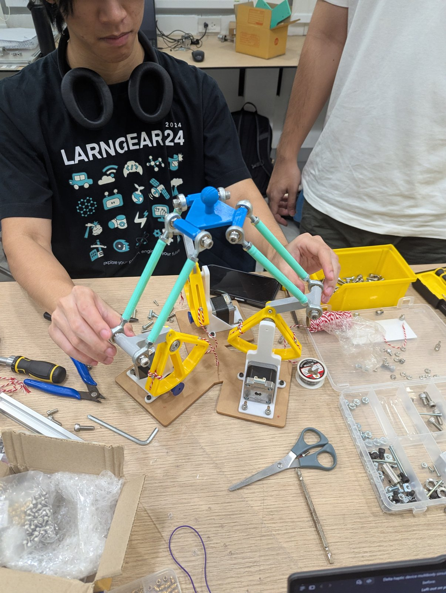 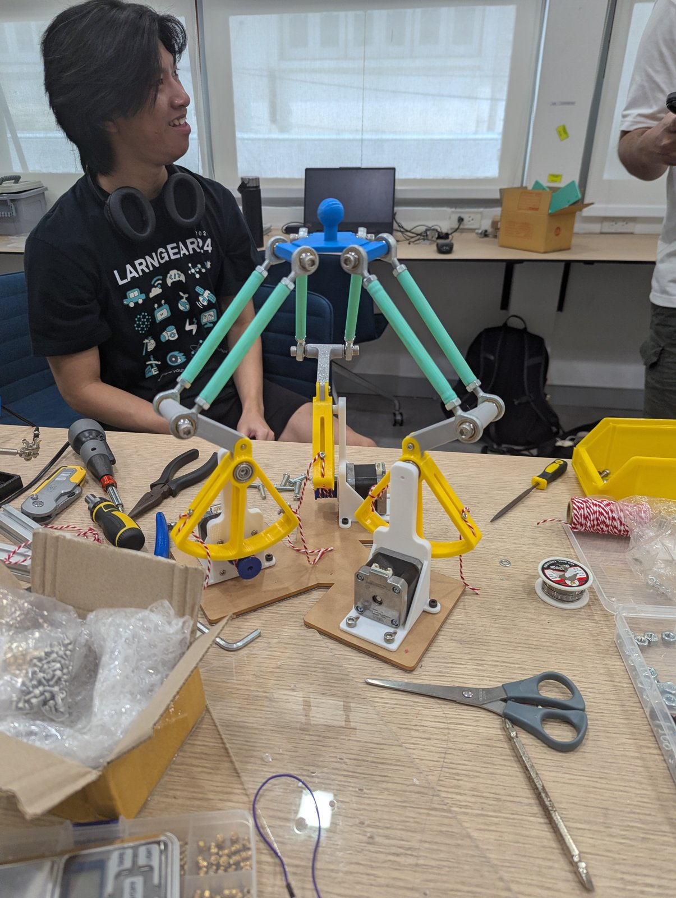  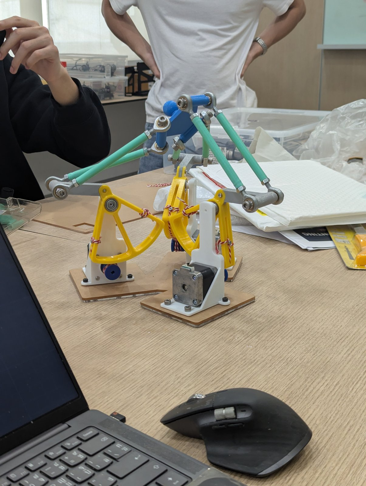
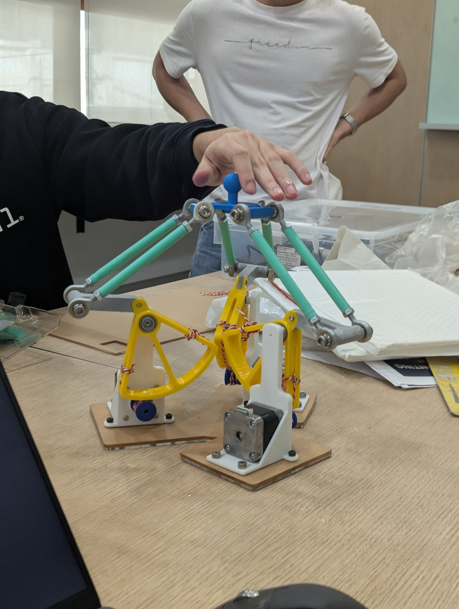 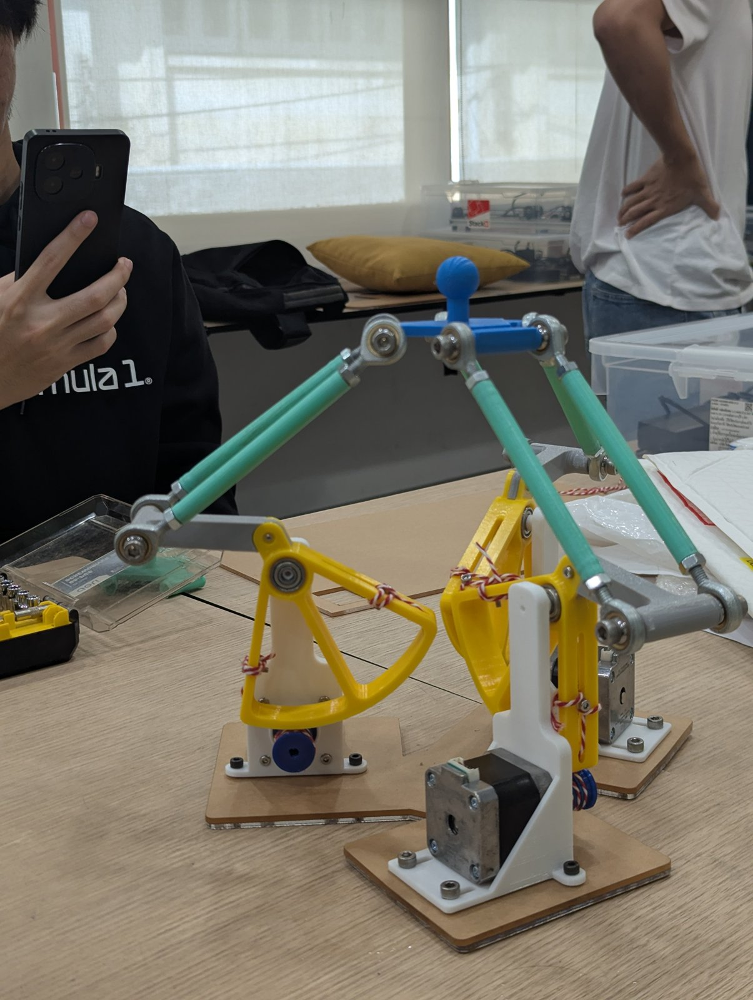 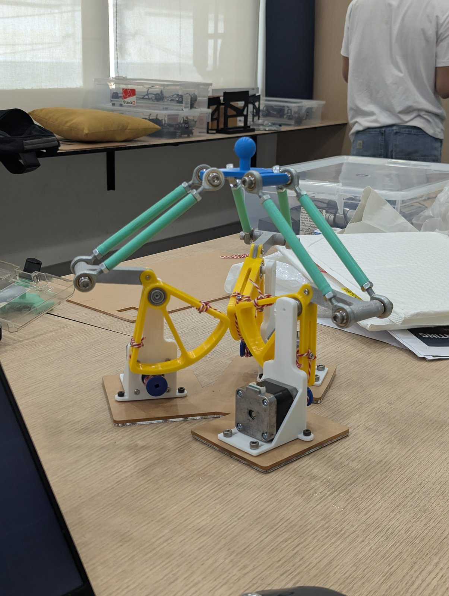 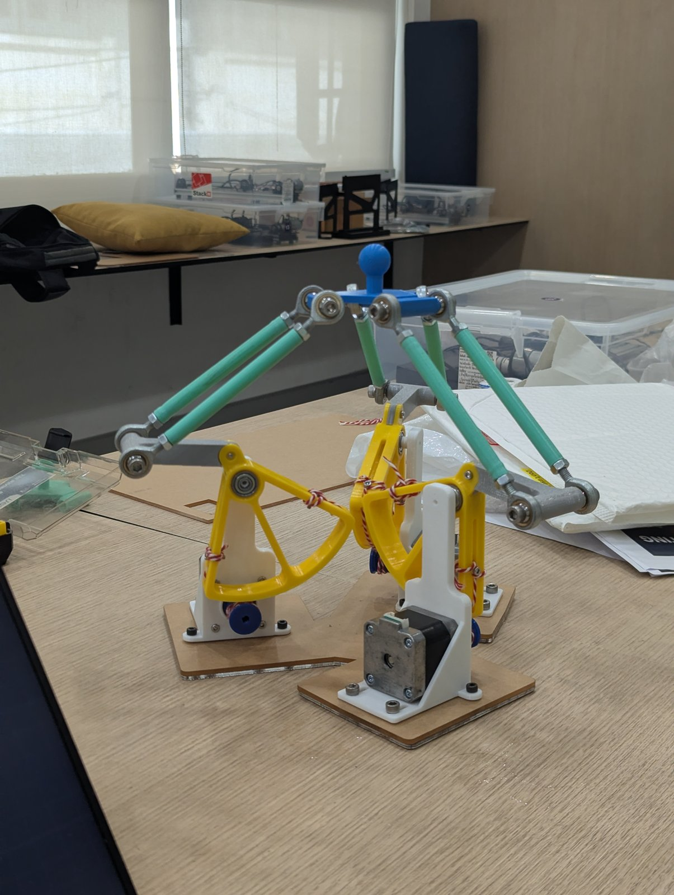

**Video:** [final_unit_demo.mp4](media/final_unit_demo.mp4)

**First prototype**

 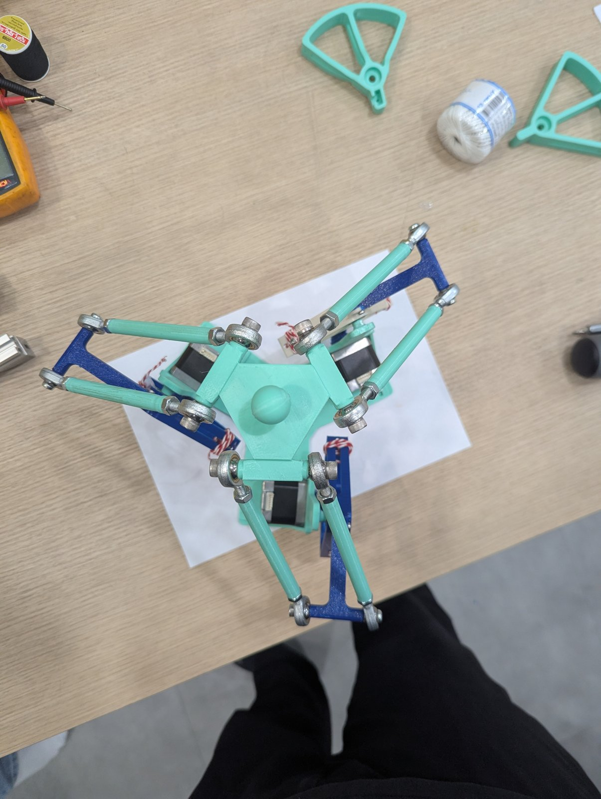 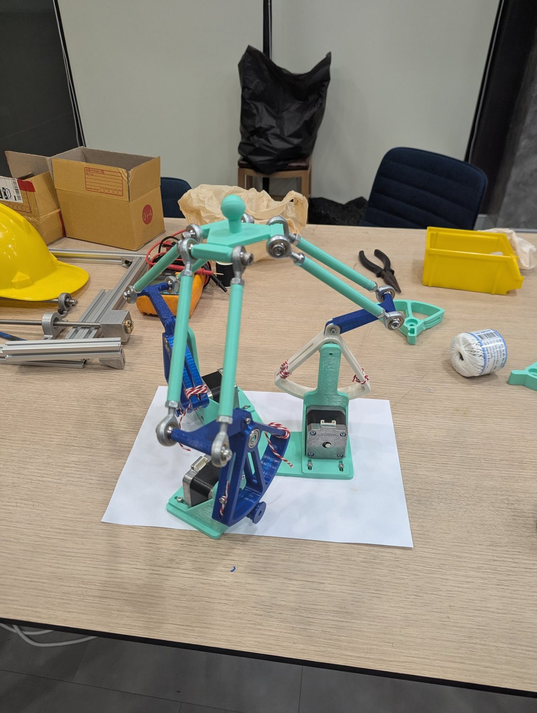

---

## Repository structure

| Path | Contents |
|---|---|
| `simulation/` | Simscape Multibody model, circle demo, symbolic circle animation |
| `hardware/mechanical/cad/` | final STEP files |
| `hardware/bom.csv` | bill of materials (template) |
| `docs/symbolic-math/` | detailed walk-through, parts 1–8, and diagrams |
| `media/` | photos and video of the unit, animation images |
