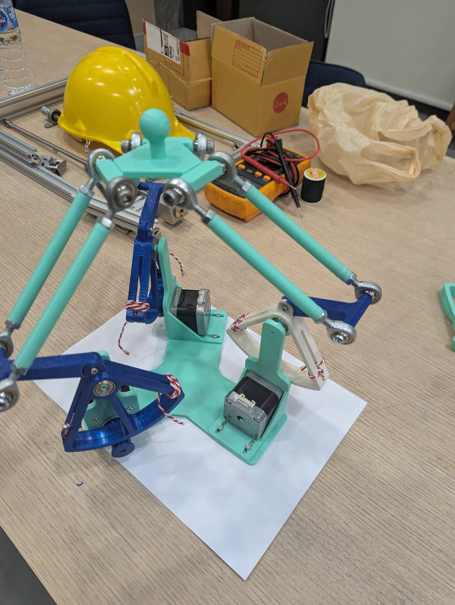

# Mechanical Engineering Project Group ไอเอิท

## Project overview

- **Project name:** Delta Haptic Device
- **Problem / purpose:** A low-cost 3-DOF haptic interface: the user holds a handle that moves in 3D, and the
  device can read its position and push back with a force. It is a delta (parallel) mechanism with three
  NEMA17 motors, each driving its arm through a rope capstan (ratio 76/9 ≈ 8.44), built from 3D-printed PETG parts.
- **Team:** 6730156021 Natchakrit Thongraya, 6730317821 Piyathon Banjong, 6730154821 Natthabhat Nilsuwan
- **Status:** Prototype assembled; CAD final; Simscape Multibody model and symbolic kinematics/dynamics done
- **Last updated:** 2026-11-11

 

## Quick start

1. MATLAB R2026a with Simulink, Simscape, Simscape Multibody and Symbolic Math Toolbox.
2. Open MATLAB in `simulation/` and run `build_delta_haptic` (builds `delta_haptic.slx` from the STEP files in
   `hardware/mechanical/cad/`), then `circle_demo`, `helix_demo` or `delta_symbolic_anim`.

Details, results and assumptions: [`simulation/README.md`](simulation/README.md). Parts: [`hardware/mechanical/README.md`](hardware/mechanical/README.md).

## Device details

| Item | Value |
|---|---|
| Mechanism | 3-DOF delta (parallel) robot, 3 legs at 120° (180°, 300°, 60° around the base) |
| Motion of the handle | Translation in x, y, z; the hand stays level (two parallel forearm rods per leg) |
| Motors | 3 × NEMA17 42BYGH40 stepper motors, TB6600 drivers, ESP32-S3 controller (bench test) |
| Drive | Rope capstan per leg: small drum on the motor shaft (r 9 mm) → big drum sector on the arm (r 76 mm), ratio 76/9 ≈ 8.44, no gears, no backlash; motor and arm turn in opposite directions |
| Rope fixing | Rope passes through Ø4 holes at both ends of the big drum arc, clamped by an M3×10 screw + nut in the drum's tension slot |
| Shoulder bearings | 2 × 606ZZ per big drum |
| Upper arm | La = 72.1 mm, shoulder pivot → elbow (from CAD) |
| Forearm | Lb = 170 mm eye to eye: PETG tube Ø10 × 100 + two M6 rod ends (M6×16 thread, 51 mm stud), M6×12 screws; rods 47 mm apart |
| Shoulder pivots | R ≈ 79–81 mm from the base centre, H = 124.1 mm above the base top |
| Hand | hand V.3, rod-end bolt lines r = 34 mm from the centre, handle sphere 27 mm above the bolt plane |
| Arm travel | −85.0° to −2.8° (arm up), limited by the rope wrap on the big drum |
| Workspace (simulated) | handle height 278.8–384.2 mm; usable circle radius ≈ 30–36 mm (limited by the rod-end tilt) |
| Materials | Printed parts PETG (1.27 g/cm³), steel fasteners, bearings and rod ends |
| Gravity load | ≈ 10.7 mN·m per motor holds the device still (simulated, at 40° arm-up) |
| Key masses (weighed) | base 250 g, bracket 32.2 g, big drum 31.3 g, connector 9.1 g, small drum 4.2 g, hand 12.9 g, rod end 20 g, forearm tube 6.8 g, motor 330 g, 606ZZ 5.7 g, M6×12 6.3 g, M3×6 0.66 g, M3×10 + nut 1.51 g |

## Assumptions

The simulation and calculations assume:

1. **Geometry** is exactly the final CAD (STEP files are final). The upper-arm length La = 72.1 mm is read from the
   CAD and not yet measured on the prototype.
2. **Rigid parts, ideal joints:** no flex in the printed parts, no play in bearings or rod ends, no assembly error.
3. **Parallel forearm rods** in each leg stay parallel and equal, so the hand never tilts.
4. **Rope** does not slip or stretch, so the capstan ratio is exactly 76/9; rope pretension and creep are ignored.
   The rope end-stops are modelled as stiff springs (2000 N·m/rad, 2 N·m·s/rad).
5. **Rod-end tilt limit is 13°** (typical M6 rod end, not from the datasheet). Paths are checked against it; the
   joints in the model do not stop by themselves.
6. **Masses:** every part uses its weighed mass (`info.txt`), spread uniformly over its CAD shape; only the steel
   rod-end balls use steel density (7850 kg/m³). The M3×10 + nut pair was weighed together and split by the nut's
   ISO size. Motor rotor inertia 54 g·cm² (typical NEMA17).
7. **Friction:** only a viscous shoulder damping of 2 mN·m·s/rad (estimate). Bearing and rope friction, stepper
   detent torque and backlash are not modelled.
8. **Motors** are ideal torque sources with no current, voltage or speed limits. (The current TB6600 stepper drivers
   cannot command torque; real force rendering needs current/torque control and encoders.)
9. **Sensing and control:** joint angles are known exactly; no encoder resolution, delay or control-loop rate.
10. **Symbolic dynamics:** each arm is one rigid body about its pivot plus N² × the motor rotor inertia; each forearm
    rod's mass is split half to the elbow and half to the hand (exact for gravity, approximate for inertia).
11. **Gravity** 9.81 m/s² along −z; the base is level and fixed to the table.
12. **Collisions** between parts are not modelled.

## Known limitations

- Workspace is set by the rod-end tilt (≈ 13°), not by the arm travel: the arms alone could reach a ≈ 80 mm radius
  circle, the rod ends allow ≈ 37 mm. The design is final, so the limit is kept in software.
- Stepper detent torque (≈ 2–6 N felt at the handle, estimated) and the TB6600 step/direction drivers make the
  device a position robot today; haptic force feedback needs torque-controlled drives and encoders.

## Repository structure

| Path | Purpose |
|---|---|
| `hardware/mechanical/` | CAD models, drawings, and fabrication files |
| `hardware/electronics/` | Schematics, PCB files, and wiring diagrams |
| `hardware/bom.csv` | Bill of materials with quantities, units, and sourcing details |
| `software/firmware/` | Microcontroller code and board setup |
| `software/application/` | PC or Raspberry Pi application code |
| `machine-skills/` | Machine commands, procedures, and skill instructions |
| `simulation/` | Models, scripts, assumptions, and simulation results |
| `docs/` | Assembly, setup, operation, and maintenance instructions |
| `media/` | Images, GIFs, and links to demonstration videos |
| `experiments/` | Procedures, raw data, and results |
| `publications/` | Project-related journal and conference papers |

