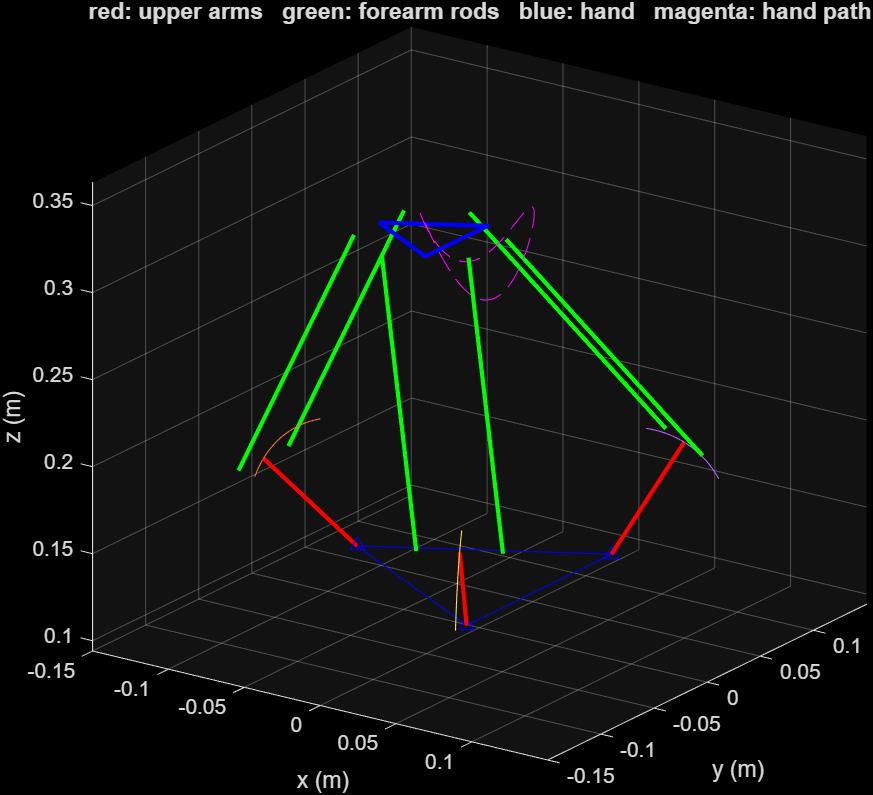

# Mechanical Engineering Project Group ไอเอิท

## Project overview

- **Project name:** Delta Haptic Device
- **Problem / purpose:** A low-cost 3-DOF haptic interface: the user holds a handle that moves in 3D, and the
  device can read its position and push back with a force. It is a delta (parallel) mechanism with three
  NEMA17 motors, each driving its arm through a rope capstan (ratio 76/9 ≈ 8.44), built from 3D-printed PETG parts.
- **Team:** 6730156021 Natchakrit Thongraya, 6730317821 Piyathon Banjong, 6730154821 Natthabhat Nilsuwan
- **Status:** Prototype assembled; CAD final; Simscape Multibody model and symbolic kinematics/dynamics done
- **Last updated:** 2026-11-11

## Quick start

1. MATLAB R2026a with Simulink, Simscape, Simscape Multibody and Symbolic Math Toolbox.
2. Open MATLAB in `simulation/` and run `build_delta_haptic` (builds `delta_haptic.slx` from the STEP files in
   `hardware/mechanical/cad/`), then `circle_demo`, `helix_demo` or `delta_symbolic_anim`.

Details, results and assumptions: [`simulation/README.md`](simulation/README.md). Parts: [`hardware/mechanical/README.md`](hardware/mechanical/README.md).

## Repository structure

| Path | Purpose |
|---|---|
| `hardware/mechanical/` | CAD models, drawings, and fabrication files |
| `hardware/electronics/` | Schematics, PCB files, and wiring diagrams |
| `hardware/bom.csv` | Bill of materials with quantities, units, and sourcing details |
| `software/firmware/` | Microcontroller code and board setup |
| `software/application/` | PC or Raspberry Pi application code |
| `machine-skills/` | Machine commands, procedures, and skill instructions |
| `simulation/` | Models, scripts, assumptions, and simulation results |
| `docs/` | Assembly, setup, operation, and maintenance instructions |
| `media/` | Images, GIFs, and links to demonstration videos |
| `experiments/` | Procedures, raw data, and results |
| `publications/` | Project-related journal and conference papers |

