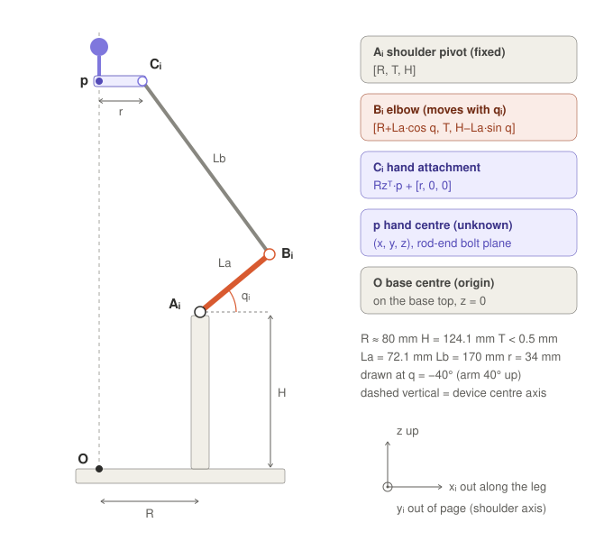
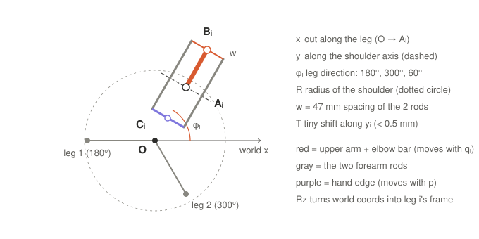

# 1. The points of one leg

Part 1 of the walk-through of the symbolic math in
[`simulation/delta_symbolic_anim.m`](../../simulation/delta_symbolic_anim.m) and
`simulation/delta_symbolic.m`.

The three legs are identical, only turned around the base by their angle φᵢ (180°, 300°, 60°). So all the
geometry is written once, in the frame of one leg:

- **xᵢ** points outward along the leg, **z** points up, **yᵢ** runs along the shoulder axis.
- **Rz** is the rotation from leg i's frame to the world frame (turn by φᵢ about z).

## Side view (leg frame, to scale, arm at q = −40°)



## Top view (leg 3 at 60° shown)



## The points

### Aᵢ: shoulder pivot (fixed)

$$A_i = [R,\ T,\ H]$$

Where the big drum turns on its two 606ZZ bearings in the motor bracket.

| Symbol | Value | Meaning |
|---|---|---|
| R | 80.95 / 79.55 / 78.83 mm | distance from the base centre (from the Base V4 screw holes, so slightly different per leg) |
| H | 124.1 mm | height above the base top |
| T | < 0.5 mm | sideways offset along the shoulder axis (practically 0) |

### Bᵢ: elbow (moves with the motor)

Start at Aᵢ and add the upper arm, length La = 72.1 mm, at angle qᵢ from horizontal:

$$B_i = A_i + L_a[\cos q_i,\ 0,\ -\sin q_i] = [R + L_a\cos q_i,\ T,\ H - L_a\sin q_i]$$

- The minus sign on sin q sets the convention: **q > 0 = arm down**, q < 0 = arm up.
- Example, leg 1 at q = −40°: B ≈ [80.9 + 55.2, 0, 124.1 + 46.3] = [136.1, 0, 170.4] mm.
- Bᵢ is the centre of the elbow bar, midway between the two rod-end bolts.

### Cᵢ: where the forearm meets the hand

$$C_i = R_z^\top p + [r,\ 0,\ 0]$$

Take the hand centre p, turn it into leg i's frame, then step r = 34 mm outward. Cᵢ is the centre of the hand edge
on that leg's side, midway between its two rod-end bolts.

### p: the hand centre (the unknown)

p = (x, y, z) is the centre of the hand's rod-end bolt plane; the handle ball is 27 mm above it. The hand never
tilts, so p alone fixes the whole hand.

### O: base centre

The origin of the world frame, on the top face of the base, on the device's centre axis.

## Why two rods count as one

The two rods of a leg are equally long and stay parallel, so with the elbow bar and the hand edge they form a
parallelogram. Then Cᵢ is always exactly Lb = 170 mm from Bᵢ, just as if a single rod joined the two bar centres.
The rod spacing w = 47 mm drops out of the equations; it only matters for drawing the rods and for the rod-end
tilt check.

This gives the one equation per leg used in the next part:

$$|C_i - B_i| = L_b$$

## In the code

```matlab
Rz   = [cos(phi(i)) -sin(phi(i)) 0; sin(phi(i)) cos(phi(i)) 0; 0 0 1];   % leg frame i -> world
A{i} = Rz*[R(i); T(i); H];                                 % shoulder pivot
B{i} = Rz*[R(i) + La*cos(q(i)); T(i); H - La*sin(q(i))];   % elbow
C{i} = p + Rz*[r; 0; 0];                                   % hand attachment
```

(The code writes the points in world coordinates, `Rz*(leg-frame point)`; the lengths between them are the same in
either frame.)

Next: [2. The forearm-length equation](02-forearm-equation.md)
