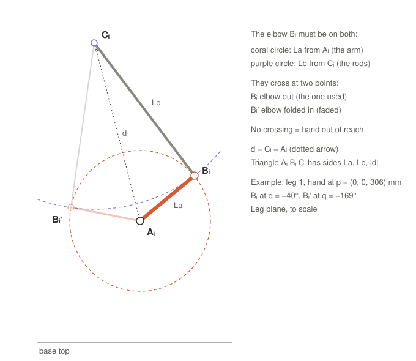

# 2. The forearm-length equation

Part 2 of the symbolic math walk-through. Previous: [1. The points of one leg](01-leg-points.md).

Once the hand position p is chosen, the shoulder Aᵢ and the hand attachment Cᵢ are fixed. Only the elbow Bᵢ can
still move, and it has to satisfy two conditions at once:



The elbow is where the two circles cross. The equation is these two conditions written as algebra.

## Step 1: the equation

$$|C_i - B_i|^2 = L_b^2$$

It is squared to avoid a square root; it says the same thing.

## Step 2: measure everything from the shoulder

Let **d** be the vector from the shoulder pivot to the hand attachment, in leg i's frame:

$$d = C_i - A_i = [d_x,\ d_y,\ d_z]$$

d depends only on where the hand is, not on q. The elbow is the shoulder plus the arm vector, so

$$C_i - B_i = d - L_a[\cos q,\ 0,\ -\sin q]$$

## Step 3: expand the square

$$|d|^2 - 2L_a(d_x\cos q - d_z\sin q) + L_a^2(\cos^2 q + \sin^2 q) = L_b^2$$

The last term is just La², since cos²q + sin²q = 1. Moving everything to one side leaves only cos q and sin q:

$$a\cos q + b\sin q + c = 0$$

$$a = -2L_a d_x,\qquad b = 2L_a d_z,\qquad c = |d|^2 + L_a^2 - L_b^2$$

In [`delta_symbolic_anim.m`](../../simulation/delta_symbolic_anim.m) the coefficients are pulled out of the expanded
equation (`a`, `b`, `c` in the solve loop); written directly:

```matlab
d   = Rz(i).'*p + [r;0;0] - [R(i); T(i); H];   % shoulder -> hand attachment, leg frame
abc = [-2*La*d(1), 2*La*d(3), sum(d.^2) + La^2 - Lb^2];
```

## Step 4: check it with numbers (leg 1, hand at p = (0, 0, 306.3) mm)

| Quantity | Value |
|---|---|
| d = C − A | [34 − 80.9, 0, 306.3 − 124.1] = [−46.9, 0, 182.2] mm |
| a = −2·72.1·(−46.9) | 6 763 mm² |
| b = 2·72.1·182.2 | 26 273 mm² |
| c = 188.1² + 72.1² − 170² | 11 695 mm² |
| a·cos(−40°) + b·sin(−40°) + c | 5 181 − 16 888 + 11 695 ≈ 0 ✓ |

So q = −40° (arm 40° up) solves the equation for this hand position.

## What it means geometrically

The bracket (d_x cos q − d_z sin q) is d projected onto the arm direction, so the equation is the **law of cosines**
for the triangle Aᵢ Bᵢ Cᵢ with sides La (arm), Lb (rods) and |d| (shoulder to hand):

$$L_b^2 = |d|^2 + L_a^2 - 2L_a|d|\cos\alpha$$

α is the angle at the shoulder between the arm and the line to the hand. In the example
cos α = 11 695 / (2·72.1·188.1) = 0.431, so α = 64.5°.

- **Two solutions.** The triangle can fold either way about the line d: elbow out (q = −40°, the one the device
  uses) or elbow folded in towards the centre (q ≈ −169°, physically impossible here).
- **Out of reach.** If |d| > La + Lb, or the hand is too close to the shoulder, the circles do not touch and there is
  no solution. This is the edge of the workspace.
- **Sideways hand motion.** If the hand moves along the shoulder axis (d_y ≠ 0), |d|² grows and the forearm circle in
  the leg plane shrinks to radius √(Lb² − d_y²). The rods then lean sideways, which is what the rod-end tilt check
  limits.

Next: 3. Solving for q (coming next), with the half-angle substitution u = tan(q/2).
