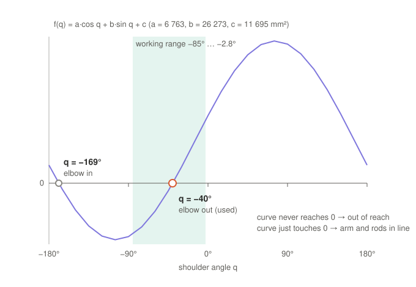

# 3. Solving a·cos q + b·sin q + c = 0 for q

Part 3 of the symbolic math walk-through. Previous: [2. The forearm-length equation](02-forearm-equation.md).

The left-hand side f(q) for the example of part 2 (leg 1, hand at p = (0, 0, 306) mm). A solution is a q where the
curve crosses zero:



The two crossings are the two elbow positions from part 2.

## Why it needs a trick

q appears twice, inside cos q and inside sin q, so it cannot simply be rearranged. The half-angle substitution turns
both into one variable.

## Step 1: substitute u = tan(q/2)

$$\cos q = \frac{1-u^2}{1+u^2},\qquad \sin q = \frac{2u}{1+u^2}$$

Substitute and multiply by (1 + u²), which is never zero:

$$a(1-u^2) + 2b\,u + c(1+u^2) = 0$$

$$(c-a)\,u^2 + 2b\,u + (c+a) = 0$$

An ordinary quadratic in u.

## Step 2: quadratic formula, then back to q

$$u = \frac{b \pm \sqrt{a^2+b^2-c^2}}{a-c}\qquad\Rightarrow\qquad q = 2\arctan(u)$$

This is what MATLAB prints as `qSol`:

```matlab
syms a b c
qSol = 2*atan(solve((c - a)*u^2 + 2*b*u + (c + a) == 0, u))
%   2*atan((b + (a^2 + b^2 - c^2)^(1/2))/(a - c))
%   2*atan((b - (a^2 + b^2 - c^2)^(1/2))/(a - c))
```

Solving once with symbols a, b, c and then substituting each leg's values keeps the result short.

## Step 3: check with numbers

| | Value |
|---|---|
| a² + b² − c² | 45.7 + 690.3 − 136.8 = 599.2 (×10⁶ mm⁴), √ = 24 479 |
| a − c | 6 763 − 11 695 = −4 932 |
| u₁ = (26 273 + 24 479)/(−4 932) | −10.29 → q = 2·atan(−10.29) = **−168.9°** (elbow in) |
| u₂ = (26 273 − 24 479)/(−4 932) | −0.364 → q = 2·atan(−0.364) = **−40.0°** (elbow out) ✓ |

## Step 4: which solution to keep

Both solve the equation; only elbow-out is physically possible, inside the rope range −85° … −2.8°. The script
picks it by comparing both with `deltaIK` at the path centre and then keeps that branch:

```matlab
val = double(subs(sol, p, p0));                         % both solutions at p0
[~, k] = min(abs(mod(val - qRef(i) + pi, 2*pi) - pi));  % the one closest to deltaIK
qIK(i) = sol(k);
```

Here that is the **minus** branch, u = (b − √…)/(a − c).

## What the square root tells you

| a² + b² − c² | Meaning |
|---|---|
| > 0 | two solutions (elbow out / elbow in): the hand is reachable |
| = 0 | one solution: arm and rods in a straight line, a singular pose where the device loses stiffness |
| < 0 | no real solution: out of reach (the circles of part 2 do not touch) |

The edge of the workspace is where a² + b² = c² for some leg.

## The same answer in another form (used in `deltaIK.m`)

Write a·cos q + b·sin q = ρ·cos(q − γ) with ρ = √(a² + b²) and γ = atan2(b, a). Then

$$q = \gamma \pm \arccos\!\left(\frac{-c}{\rho}\right)$$

It gives the same two angles and is cheaper numerically, so [`deltaIK.m`](../../simulation/deltaIK.m) uses it. The
half-angle form suits `solve()` because it is a polynomial.

Next: [4. Velocity and the Jacobian](04-velocity-jacobian.md)
