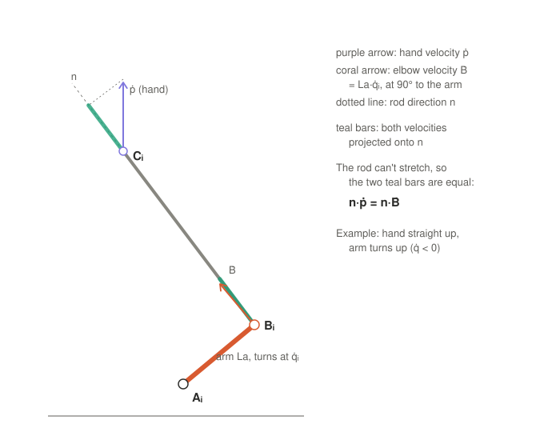

# 4. Velocity and the Jacobian

Part 4 of the symbolic math walk-through. Previous: [3. Solving for q](03-solving-for-q.md).

Part 3 gave positions: hand position p in, shoulder angles q out. Now the rates: how fast does each arm turn when
the hand moves at speed ṗ? The key idea is that a rod cannot change length, so both of its ends move at the same
speed along it:

## Step 1: differentiate the constraint

The forearm equation holds at every instant:

$$\Phi_i(p, q_i) = |C_i - B_i|^2 - L_b^2 = 0$$

so its time derivative is zero too (chain rule):

$$\frac{d\Phi_i}{dt} = \frac{\partial\Phi_i}{\partial p}\,\dot p + \frac{\partial\Phi_i}{\partial q_i}\,\dot q_i = 0$$

For all three legs:

$$\Phi_p\,\dot p + \Phi_q\,\dot q = 0$$

## Step 2: what the two derivatives are

Write the rod as Cᵢ − Bᵢ = Lb·nᵢ, with nᵢ the unit vector along the rod:

| Term | Formula | Meaning |
|---|---|---|
| row i of Φₚ | 2(Cᵢ − Bᵢ)ᵀ = 2Lb·nᵢᵀ | the rod direction |
| diagonal of Φ_q | −2(Cᵢ − Bᵢ)·∂Bᵢ/∂qᵢ = −2Lb·La·(nᵢ·tᵢ) | how much an arm turn stretches the rod |

tᵢ = [−sin q, 0, −cos q] is the direction the elbow moves when q increases. Φ_q is **diagonal** because each leg's
equation contains only its own qᵢ.

Dividing by 2Lb, each row says exactly what the picture shows, the speed along the rod is the same at both ends:

$$n_i\cdot\dot p = L_a\,(n_i\cdot t_i)\,\dot q_i$$

## Step 3: solve both ways

**Inverse (hand speed → arm speeds)**, each leg on its own:

$$\dot q_i = \frac{n_i\cdot\dot p}{L_a\,(n_i\cdot t_i)}\qquad\Longleftrightarrow\qquad \dot q = J^{-1}\dot p,\quad J^{-1} = -\Phi_q^{-1}\Phi_p$$

Φ_q is diagonal, so no matrix inverse is needed, only a division per row: `Jinv = -Pp ./ pq` in
[`delta_kinematics_inv.m`](../../simulation/delta_kinematics_inv.m).

**Forward (arm speeds → hand speed)** needs a real 3×3 inverse, because the three rods share the hand:

$$\dot p = J\dot q,\qquad J = -\Phi_p^{-1}\Phi_q$$

J is the **Jacobian**, the matrix between motor motion and handle motion.

## Step 4: numbers (leg 1, hand at p = (0, 0, 306.3) mm, q = −40°)

| Quantity | Value |
|---|---|
| rod Cᵢ − Bᵢ (leg frame) | [34 − 136.1, 0, 306.3 − 170.4] = [−102.1, 0, 135.9] mm, length 170 ✓ |
| n | [−0.601, 0, 0.799] |
| t at q = −40° | [0.643, 0, −0.766] |
| n·t | −0.999, the rod is almost exactly at 90° to the arm |
| La·(n·t) | −72.0 mm/rad |

Hand straight up at 100 mm/s: n·ṗ = 0.799·100 = 79.9 mm/s, so q̇ = 79.9 / (−72.0) = **−1.11 rad/s (−63.6°/s)**, the
same for all three arms (all turn up together). In other words, 1° on every arm moves the hand up 1.57 mm, and with
the 8.44 capstan, 1° at the motor moves the hand 0.19 mm.

A rod almost at 90° to its arm is the best case: the arm's motion goes almost entirely into pushing the rod.

## Step 5: when it breaks down (singularities)

| Condition | What happens |
|---|---|
| nᵢ·tᵢ = 0, rod in line with the arm | J⁻¹ → ∞: the arm cannot push the rod (the a² + b² = c² edge of part 3) |
| Φₚ singular, the three rods in one plane | J → ∞: the hand can move without any arm moving, the device feels loose |

## In the code

- [`delta_symbolic_anim.m`](../../simulation/delta_symbolic_anim.m): `dq_t = diff(q_t, t)` applies the chain rule
  directly, (∂q/∂p)·ṗ = J⁻¹ṗ; checked against `delta_kinematics_inv` at 13 times to 1e-8.
- [`delta_symbolic.m`](../../simulation/delta_symbolic.m): `Phi_p = jacobian(Phi, p)`, `Phi_q = jacobian(Phi, q)`,
  generated as `delta_sym_Phi_p.m` / `delta_sym_Phi_q.m`; `delta_kinematics.m` forms J = −Φₚ⁻¹Φ_q from them.

The same J also maps forces: τ = Jᵀ·F turns a force at the hand into shoulder torques (part 6, dynamics).

Next: 5. Acceleration (coming next).
