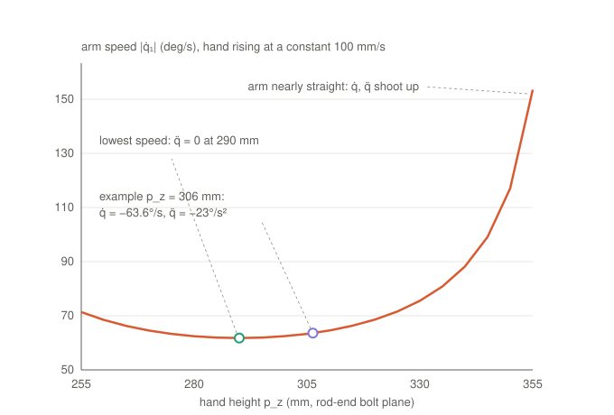

# 5. Acceleration

Part 5 of the symbolic math walk-through. Previous: [4. Velocity and the Jacobian](04-velocity-jacobian.md).

Suppose the hand rises at a perfectly constant 100 mm/s, so p̈ = 0. One might expect the arms to turn at a constant
rate too. They do not; this is the real arm speed of leg 1 (from `deltaIK`):

The arm speed changes, so the arm has an angular acceleration q̈ ≠ 0 caused purely by the changing geometry. That
extra part is what this section is about.

## Step 1: differentiate again

Differentiate the velocity equation of part 4, Φₚṗ + Φ_q q̇ = 0. Φₚ and Φ_q change as the device moves, so the
product rule adds one term:

$$\Phi_p\,\ddot p + \Phi_q\,\ddot q + \underbrace{\dot\Phi_p\,\dot p + \dot\Phi_q\,\dot q}_{c(p,\,q,\,\dot p,\,\dot q)} = 0$$

**c** contains only products of velocities (q̇², ṗ²): zero when nothing moves, growing with speed squared.

## Step 2: what c is physically

Differentiating |Cᵢ − Bᵢ|² = Lb² twice and dividing by 2Lb gives, per leg:

$$n_i\cdot\ddot p = L_a(n_i\cdot t_i)\,\ddot q_i - \underbrace{L_a\dot q_i^2\,(n_i\cdot e_i)}_{\text{elbow centripetal}} - \underbrace{\frac{|\dot p - \dot B_i|^2}{L_b}}_{\text{rod swinging}}$$

- The first term is the part 4 velocity rule, now for accelerations.
- **Elbow centripetal**: the elbow moves on a circle, so it always accelerates towards the shoulder by La·q̇²
  (eᵢ = [cos q, 0, −sin q] is the arm direction).
- **Rod swinging**: the rod itself rotates; its ends have relative speed |ṗ − Ḃ|, which gives a centripetal
  acceleration |ṗ − Ḃ|²/Lb along the rod.

## Step 3: check with numbers (leg 1, p = (0, 0, 306.3) mm, ṗ = 100 mm/s up, p̈ = 0)

| Quantity | Value |
|---|---|
| q̇ (part 4) | −1.11 rad/s |
| e = [cos q, 0, −sin q] | [0.766, 0, 0.643], n·e = 0.053 |
| elbow term La·q̇²·(n·e) | 72.1 · 1.232 · 0.053 = 4.7 mm/s² |
| Ḃ = La·q̇·t | [−51.5, 0, 61.3] mm/s |
| rod term \|ṗ − Ḃ\|²/Lb | (51.5² + 38.7²)/170 = 24.4 mm/s² |
| solve 0 = −72.0·q̈ − 4.7 − 24.4 | **q̈ = −0.405 rad/s²** |
| MATLAB (`deltaIK` finite difference and `delta_kinematics_inv`) | −0.404 rad/s² ✓ |

To keep the hand at constant speed the arm must keep speeding up by about 23°/s², mostly because the rod swings.

## Step 4: solve both ways

**Inverse (hand motion → arm accelerations)**, `delta_kinematics_inv.m`:

$$\ddot q = -\Phi_q^{-1}\big(\Phi_p\,\ddot p + c\big)$$

(each row a simple division, Φ_q is diagonal)

**Forward (arm motion → hand acceleration)**, `delta_kinematics.m`:

$$\ddot p = J\ddot q + \beta,\qquad \beta = -\Phi_p^{-1}c$$

β is the hand acceleration even when the motors spin at constant speed (q̈ = 0), the mirror image of the plot. The
dynamics (part 6) need it: moving the hand's mass takes force even when the motors are not speeding up.

## What the plot shows

| Hand height | What happens |
|---|---|
| ≈ 290 mm | lowest arm speed, q̈ = 0: the geometry passes its best transmission |
| 255–330 mm (normal working range) | arm speed only 62–76°/s, easy to drive |
| above 340 mm | arm nearly straight against its rope stop (q → −85°): n·t → 0, so q̇ and q̈ blow up (154°/s and over 1100°/s² at 355 mm). The singular edge of parts 3 and 4, and the reason the demos keep a margin from the rope stops |

## In the code

- [`delta_symbolic_anim.m`](../../simulation/delta_symbolic_anim.m): `ddq_t = diff(q_t, t, 2)`; the chain rule
  produces every c-term automatically.
- `delta_symbolic.m`: `c = jacobian(Phi_p*dp + Phi_q*dq, [p; q]) * [dp; dq]`,
  generated as `delta_sym_c.m`; agrees with finite differences to about 1e-7.

Next: [6. Dynamics](06-dynamics.md)
