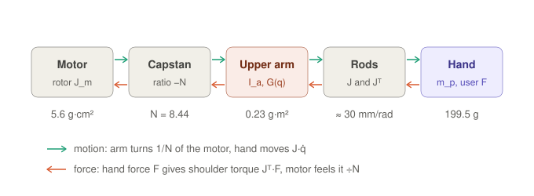

# 6. Dynamics: from motor torque to hand force

Part 6 of the symbolic math walk-through. Previous: [5. Acceleration](05-acceleration.md).

So far only geometry. Now mass and force. Each leg is a chain of five elements; motion goes from the motor to the
hand, force comes back:



Values come from `delta_symbolic.m`, which measures masses, centres of mass and
inertias from the Simscape model with Inertia Sensors, so the equations match the model exactly.

## Step 1: motor and capstan

The capstan multiplies torque by N and reverses the direction:

$$\tau_s = -N\,\tau_m$$

The rotor spins N times faster than the arm, so the arm feels its inertia times **N²**:

$$N^2 J_m = 71.3 \times 5.6\ \text{g·cm}^2 = 0.40\ \text{g·m}^2$$

That is half of each arm's total inertia: the small rotor dominates because of the ratio.

## Step 2: the upper arm

One rigid body turning about its shoulder:

$$M_q = I_a + N^2 J_m + m_r L_a^2 = 0.238 + 0.399 + 0.187 = 0.824\ \text{g·m}^2$$

| Part | Value | What it is |
|---|---|---|
| I_a | 0.238 g·m² | big drum, connector, bearings, screws (measured from the Simscape model) |
| N²J_m | 0.399 g·m² | motor rotor + small drum, as felt through the capstan |
| m_r·La² | 0.187 g·m² | the elbow halves of the two rods at radius La (m_r = 35.9 g = one rod) |

Gravity acts at the arm's centre of mass; the code writes the potential energy V and differentiates it:

```matlab
V  = sum(ma*g*(H - cxa*sin(q) - cya*cos(q)) + mr*g*(H - La*sin(q)));   % arms + elbow rod halves
Gq = jacobian(V, q).';                                                  % gravity torque per arm
```

At q = −40°, G = −34.6 mN·m per arm (arm 79.1 g plus the elbow rod halves).

## Step 3: the hand

The hand carries its own mass plus the other half of all six rods:

$$m_p = m_h + 3m_r = 83.4 + 107.7 = 191.1\ \text{g}$$

m_h = 83.4 g is the hand group: hand V.3 (12.9 g) + six M6×12 screws (6 × 6.3 g) + six rod-end balls (6 × 5.5 g).
m_r = 35.9 g is one rod: tube (6.8 g) + two rod-end housings (20 g each minus the 5.5 g ball).

Newton for the hand: m_p·(p̈ + g·e_z) = F + (rod forces), with F the force of the user's hand.

## Step 4: the rods connect them through Jᵀ

The rods are treated as massless (their mass was split in steps 2 and 3), so they pass power straight through:
power in at the arms equals power out at the hand,

$$\tau^\top\dot q = f^\top\dot p = f^\top J\dot q\qquad\Rightarrow\qquad \tau = J^\top f$$

The Jacobian of part 4 maps motion forward (ṗ = J q̇) and force backward (τ = Jᵀ f): the principle of virtual work.

## Step 5: put it together

Insert p̈ = J q̈ + β (part 5) into the hand equation, bring it to the shoulders with Jᵀ, add the arm equation:

$$(M_q + m_p J^\top J)\,\ddot q = \tau_s - G(q) - b\,\dot q - J^\top\big(m_p(\beta + g\,e_z) - F\big)$$

| Term | Meaning |
|---|---|
| M_q + m_p·JᵀJ | total inertia at the shoulders: arms + the hand's mass seen through the linkage |
| τ_s = −N·τ_m | the motors' torque at the shoulders |
| G(q) | gravity on the arms |
| b·q̇ | shoulder damping (2 mN·m·s/rad, estimate) |
| Jᵀ·m_p·β | force needed to follow the geometry-driven curved motion (part 5) |
| Jᵀ·m_p·g·e_z | weight of hand + rods, carried to the shoulders |
| Jᵀ·F | the user's push, carried to the shoulders |

This is `delta_dynamics.m`: motor torques and user force in, arm accelerations
out. Checked against Simscape: released from rest, the start accelerations agree within 0.9 %.

## Step 6: backwards, motor torques for haptics

`delta_motor_torque.m` solves the same equation for τ_m. Held still
(q̇ = 0, q̈ = 0):

$$\tau_m = -\frac{G(q) + J^\top\big(m_p\,g\,e_z + F_{\text{hand}}\big)}{N}$$

F_hand is the force the device should push on the user (F = −F_hand). At the home pose (q = −40°,
p = (0, 0, 306) mm):

| Case | Motor torque, legs 1 / 2 / 3 |
|---|---|
| just float (gravity compensation) | 10.8 / 10.7 / 10.6 mN·m (4.1 from the arm's weight, 6.7 from hand + rods) |
| also push the user 1 N down | 7.2 / 7.2 / 7.1 mN·m (the user's upward push helps hold it) |
| also push the user 1 N sideways (+x) | 20.3 / 6.0 / 5.9 mN·m (leg 1 does most of the work) |

Simscape confirms the gravity compensation: with these torques the model stays still (0.00 % of free-fall
acceleration).

What this means for haptics:

- **Force per torque**: 1 N at the hand needs only ≈ 3.6–9.5 mN·m at the motor, thanks to the capstan and J.
- **Inertia you feel**: the user feels M_q + m_p·JᵀJ through the handle; half of M_q is the rotor times N². A lower
  ratio or lighter motor would feel more transparent.
- **Detent torque**: a stepper's detent torque (≈ 20 mN·m) is bigger than the whole gravity-compensation torque,
  which is why steppers feel "notchy" in a haptic device.

Next: [7. Putting it together in the animation script](07-animation-script.md)
