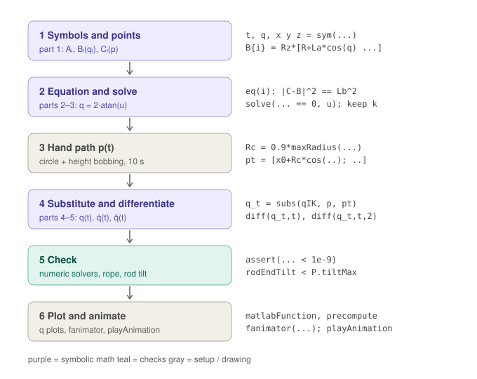

# 7. Putting it together: how `delta_symbolic_anim.m` runs

Part 7 (last) of the symbolic math walk-through. Previous: [6. Dynamics](06-dynamics.md).

[`delta_symbolic_anim.m`](../../simulation/delta_symbolic_anim.m) does parts 1–5 in order, checks itself, then
draws:



## Step 1: symbols and points (part 1)

```matlab
t = sym('t','real');  q = sym('q',[3 1],'real');  syms x y z real;  p = [x; y; z];
B{i} = Rz*[R(i) + La*cos(q(i)); T(i); H - La*sin(q(i))];   C{i} = p + Rz*[r; 0; 0];
```

Parameters (R, H, La, Lb, r, φ) are loaded from `delta_symbolic.mat`, the same numbers as the Simscape model.

## Step 2: equation and solve (parts 2–3)

`eq(i)` is |Cᵢ − Bᵢ|² == Lb². The loop pulls out a, b, c, solves the quadratic in u = tan(q/2) and keeps the
elbow-out solution by comparing both with `deltaIK`. `qIK` is then three formulas q₁, q₂, q₃(x, y, z);
`vpa(qIK, 4)` prints them with 4 digits (the exact form is full of huge fractions).

## Step 3: the hand path

$$p(t) = \big[x_0 + R_c\cos\tfrac{2\pi t}{5},\ \ y_0 + R_c\sin\tfrac{2\pi t}{5},\ \ z_0 + 0.02\sin\tfrac{4\pi t}{5}\big]$$

- Centre p₀: hand position with every arm at mid-travel.
- Rc = 0.9 × the largest circle `maxRadius` allows over the ±20 mm height range, 1° clear of the rope stops and the
  rod-end tilt limit, giving Rc = 30.7 mm.
- 5 s per lap, 2 laps; the height goes up and down twice per lap.

## Step 4: substitute and differentiate (parts 4–5)

```matlab
q_t   = subs(qIK, p, pt);     % q(x,y,z) -> q(t)
dq_t  = diff(q_t, t);         % chain rule: J^-1 * pdot
ddq_t = diff(q_t, t, 2);      % includes all the c-terms of part 5
```

The toolbox does the work of parts 4 and 5 automatically: J and c are never formed by hand here, the chain rule
through `subs` produces them.

## Step 5: check

| Check | Tolerance | Result |
|---|---|---|
| q(t) vs `deltaIK` at 13 times | 1e-9 rad | ✓ (≈ 1e-14) |
| q̇, q̈ vs `delta_kinematics_inv` | 1e-8 relative | ✓ (≈ 1e-15) |
| rope stops, every sample | −85° … −2.8° | q in −73.5° … −17.6° ✓ |
| rod-end tilt, every sample | < 13° | max 10.8° ✓ |

A failed check stops the script with a message, so a wrong branch or an unreachable path cannot quietly produce a
wrong animation.

## Step 6: plot and animate

- `matlabFunction` turns the long symbolic results into fast numeric functions (evaluating with `subs` every frame
  made the first version take 218 s).
- The *Shoulder kinematics* figure plots q, q̇, q̈ for all three legs.
- The elbow points Bᵢ(t) and hand points Cᵢ(t) are computed once for all 201 frames (20 fps, 10 s).
- `fanimator` gets three drawing functions, one per colour: upper arms (red), rod pairs (green, each rod w/2 either
  side along vᵢ), hand triangle (blue). Each draws one line object with NaN gaps, since `fanimator` needs exactly one
  object per function.
- `playAnimation` plays it in real time. The magenta dashed line is the hand path, the thin arcs the elbow paths.

## The whole chain on one page

| Part | Question | Answer |
|---|---|---|
| [1](01-leg-points.md) | where is everything? | Aᵢ fixed, Bᵢ(qᵢ) on the arm, Cᵢ(p) on the hand |
| [2](02-forearm-equation.md) | what links them? | each forearm stays Lb long: a·cos q + b·sin q + c = 0 |
| [3](03-solving-for-q.md) | hand → angles | q = 2·atan((b ± √(a² + b² − c²))/(a − c)), elbow out |
| [4](04-velocity-jacobian.md) | hand speed ↔ arm speed | Φₚṗ + Φ_q q̇ = 0 → ṗ = J q̇ |
| [5](05-acceleration.md) | accelerations | Φₚp̈ + Φ_q q̈ + c = 0 → p̈ = J q̈ + β |
| [6](06-dynamics.md) | forces | (M_q + m_p JᵀJ)q̈ = τ_s − G − b q̇ − Jᵀ(m_p(β + g e_z) − F), τ_m = −τ_s/N |
| 7 | does it agree? | the animation checks parts 2–5 against the numeric solvers; `delta_symbolic.m` checks part 6 against Simscape (gravity compensation 0.00 % residual, free fall within 0.9 %) |

**Not in the animation:** forces. It is kinematics only. A natural next step is to call `delta_motor_torque` along
the same path and add the motor torques needed to float the device and move it round the circle.
