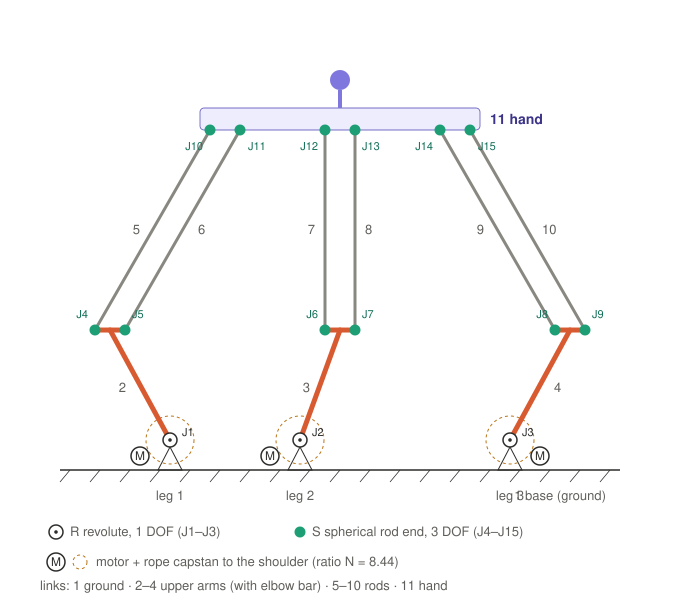

# 8. Degrees of freedom and kinematic diagram

Part 8 of the symbolic math walk-through. Previous: [7. Putting it together](07-animation-script.md).

## Kinematic diagram

## Links

| # | Link | Count | Moves? |
|---|---|---|---|
| 1 | base: plate, brackets, motors (all fixed together) | 1 | no, ground |
| 2–4 | upper arm: big drum, connector, elbow bar, bearings, screws | 3 | yes |
| 5–10 | forearm rod: tube + two rod-end housings | 6 | yes |
| 11 | hand: hand V.3, handle, rod-end screws | 1 | yes |
| | **total n** | **11** | 10 moving |

## Joints

| Joint | Leg | Connects (link ↔ link) | Physical part | Type | f (DOF) | Removes (6 − f) |
|---|---|---|---|---|---|---|
| J1 | 1 | base (1) ↔ upper arm (2) | shoulder, 2 × 606ZZ | R revolute | 1 | 5 |
| J2 | 2 | base (1) ↔ upper arm (3) | shoulder, 2 × 606ZZ | R revolute | 1 | 5 |
| J3 | 3 | base (1) ↔ upper arm (4) | shoulder, 2 × 606ZZ | R revolute | 1 | 5 |
| J4 | 1 | upper arm (2) ↔ rod a (5) | elbow rod end | S spherical | 3 | 3 |
| J5 | 1 | upper arm (2) ↔ rod b (6) | elbow rod end | S spherical | 3 | 3 |
| J6 | 2 | upper arm (3) ↔ rod a (7) | elbow rod end | S spherical | 3 | 3 |
| J7 | 2 | upper arm (3) ↔ rod b (8) | elbow rod end | S spherical | 3 | 3 |
| J8 | 3 | upper arm (4) ↔ rod a (9) | elbow rod end | S spherical | 3 | 3 |
| J9 | 3 | upper arm (4) ↔ rod b (10) | elbow rod end | S spherical | 3 | 3 |
| J10 | 1 | rod a (5) ↔ hand (11) | hand rod end | S spherical | 3 | 3 |
| J11 | 1 | rod b (6) ↔ hand (11) | hand rod end | S spherical | 3 | 3 |
| J12 | 2 | rod a (7) ↔ hand (11) | hand rod end | S spherical | 3 | 3 |
| J13 | 2 | rod b (8) ↔ hand (11) | hand rod end | S spherical | 3 | 3 |
| J14 | 3 | rod a (9) ↔ hand (11) | hand rod end | S spherical | 3 | 3 |
| J15 | 3 | rod b (10) ↔ hand (11) | hand rod end | S spherical | 3 | 3 |
| **Total** | | | | **j = 15** | **Σf = 39** | **Σ = 51** |

| Type | Allows | Blocks | f |
|---|---|---|---|
| R revolute (shoulder) | 1 rotation, about the shoulder axis | 3 translations + 2 rotations | 1 |
| S spherical (rod end) | 3 rotations about the ball centre (within ±13° tilt) | 3 translations | 3 |

## Grübler–Kutzbach equation (spatial)

A free rigid body in space has 6 DOF. Start with every moving link free, then subtract what each joint removes:

$$M = 6(n-1) - \sum_{i=1}^{j}(6 - f_i) \qquad\Longleftrightarrow\qquad M = 6(n - 1 - j) + \sum_{i=1}^{j} f_i$$

$$\sum f_i = \underbrace{1+1+1}_{J1\text{–}J3} + \underbrace{3\times 6}_{J4\text{–}J9} + \underbrace{3\times 6}_{J10\text{–}J15} = 3 + 18 + 18 = 39$$

$$M = 6(11 - 1 - 15) + 39 = 6(-5) + 39 = \mathbf{9}$$

The same with removed freedoms:

$$M = 6 \times 10 - (\underbrace{5+5+5}_{J1\text{–}J3} + \underbrace{3\times 12}_{J4\text{–}J15}) = 60 - 51 = 9$$

## Useful and idle DOF

A rod with a ball joint at both ends can spin about the line through its two ball centres without moving anything
else: an **idle (passive) DOF**.

| Type | Count | Effect |
|---|---|---|
| rod spin about its own axis | 6 (one per rod) | none, the rod turns in its rod-end housings |
| hand motion | 9 − 6 = **3** | the useful mobility |

The 3 useful DOF are **pure translation x, y, z**. In each leg the two equal, parallel rods form a parallelogram
with the elbow bar and the hand edge, so the hand edge stays parallel to its elbow bar. The three elbow bars point in
three directions (legs 120° apart), which locks all three rotations of the hand.

## Drive chain (motors and capstans)

Each motor rotor + small drum adds one body and one revolute joint (+1) and is tied to its arm by the rope, a
gear-like coupling (−1):

| | n | j | Σf | M |
|---|---|---|---|---|
| mechanism only | 11 | 15 | 39 | 9 |
| + 3 rotors on revolute joints | 14 | 18 | 42 | 6(14 − 1 − 18) + 42 = 12 |
| + 3 rope couplings (−1 each) | | | | 12 − 3 = **9** |

Unchanged: **3 motors drive the 3 useful DOF**, the device is fully actuated and not redundant.

## Simscape model

The model uses a universal joint (U, f = 2) at the elbows J4–J9 instead of a ball joint, so the rods cannot spin
(a free spin drifts numerically in simulation):

$$\sum f = 3(1) + 6(2) + 6(3) = 33,\qquad M = 6(11 - 1 - 15) + 33 = \mathbf{3}$$
