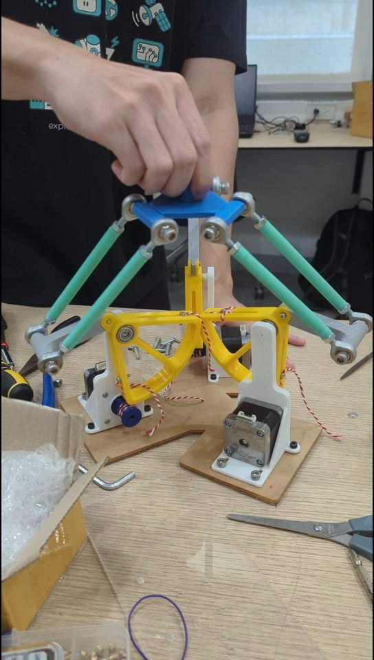
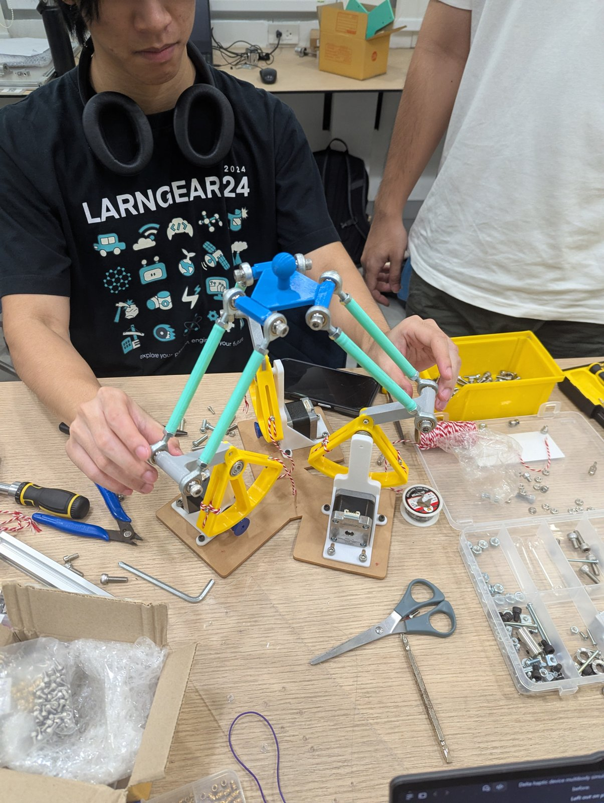
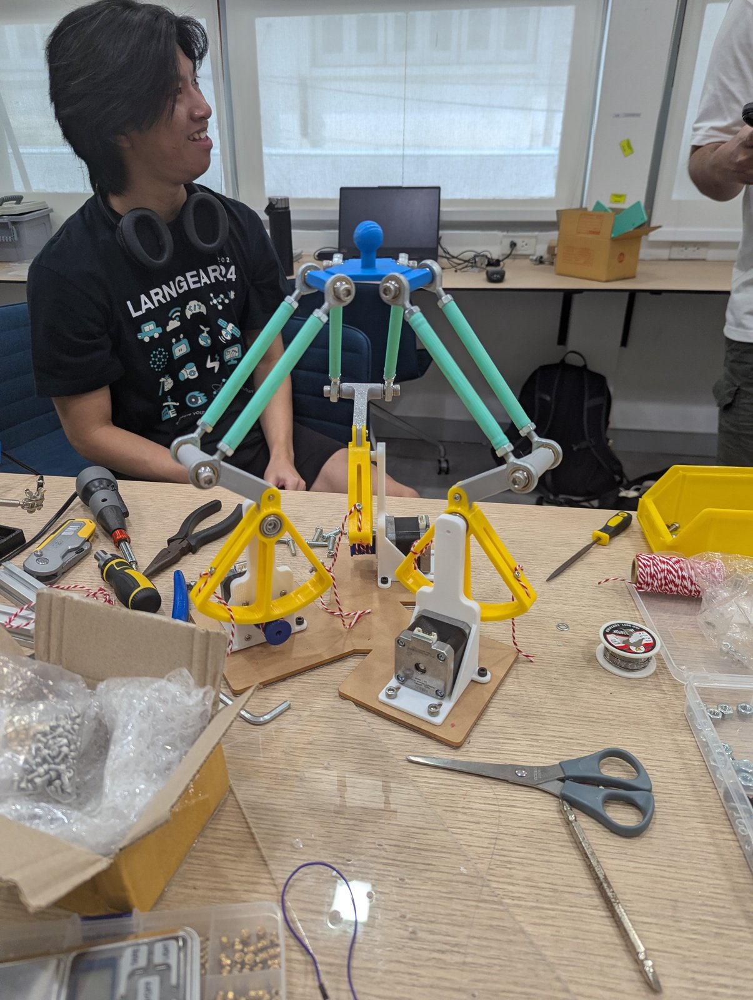
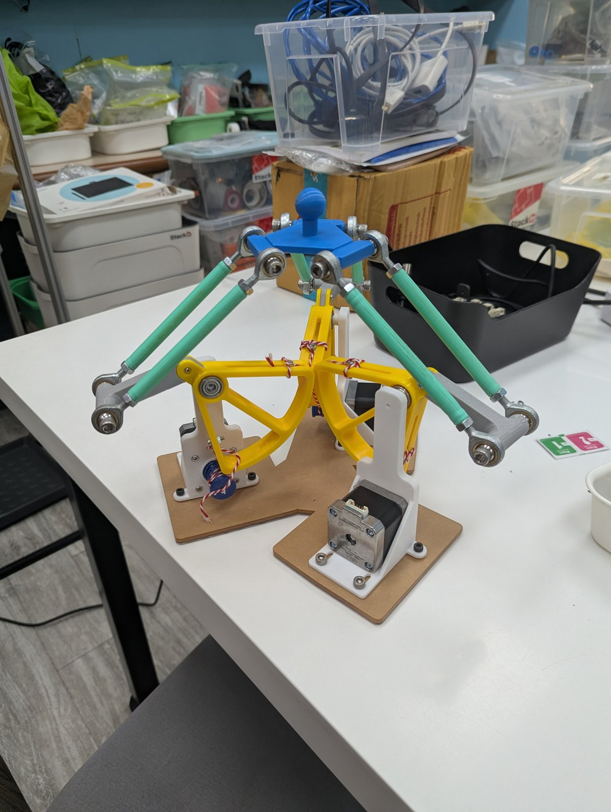
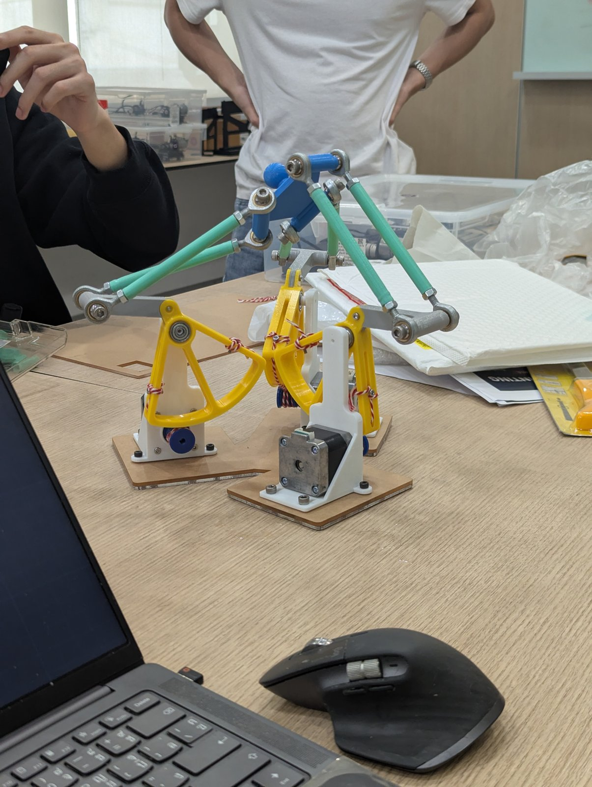
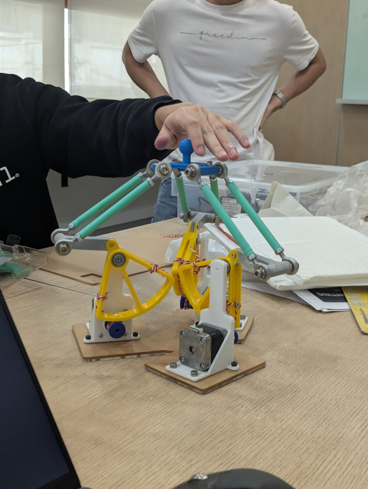
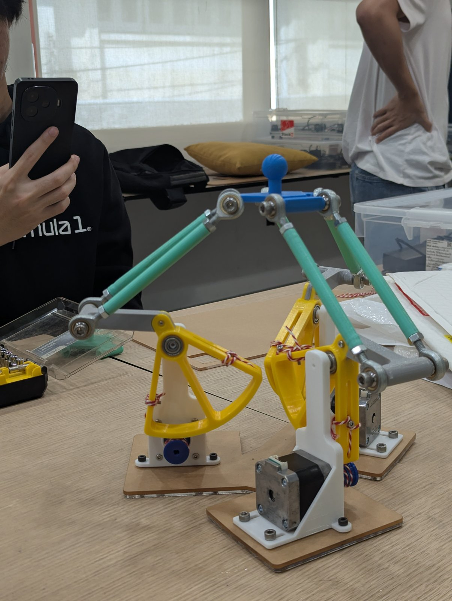
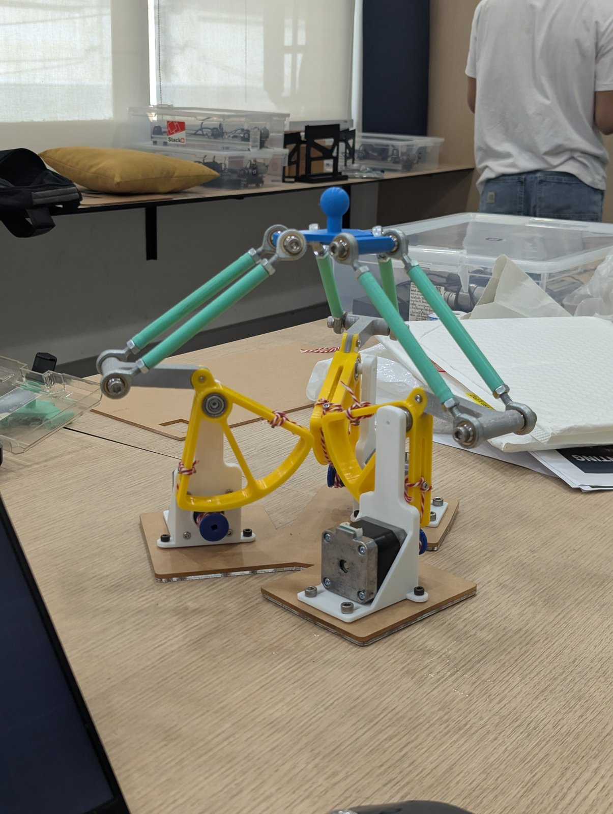
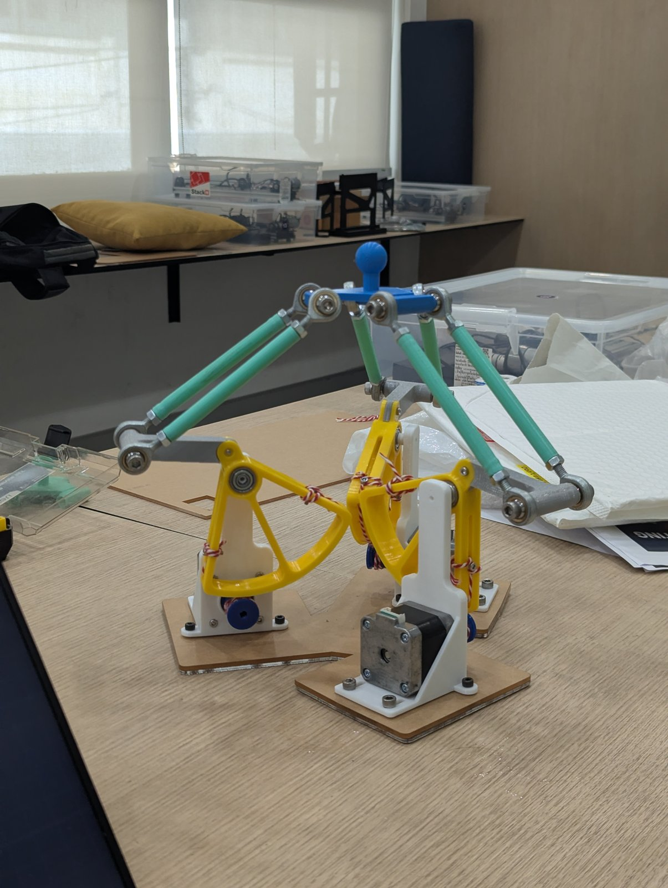

# Media

## Real unit (built 2026-11-11)

Photos downscaled to 1600 px, video to 544 × 960 without sound; all metadata removed.

[`real-unit/real_unit_demo.mp4`](real-unit/real_unit_demo.mp4) (18.5 s): the handle is moved by hand up, down and
sideways; the three arms swing and the capstan ropes turn the motor shafts.

| Photo | Caption |
|---|---|
|  | **1.** Final assembly: fitting the mint forearm rods (M6 rod ends) to the grey elbow connectors on the yellow capstan arms |
|  | **2.** First complete assembly on the workbench: blue hand with handle, six forearm rods, three legs |
|  | **3.** Finished unit, front three-quarter view: yellow big drums, white motor brackets, NEMA17 motors, wooden base plates |
|  | **4.** Side view with the hand pushed off-centre: one arm swings up, the others down, the hand stays level |
|  | **5.** Moving the handle by hand: the parallelogram rods keep the hand horizontal |
|  | **6.** Side view in a working pose, close-up of the capstan drums and rope |
|  | **7.** Side view at rest: arms up, red/white rope wrapped on the big drums |
|  | **8.** Side view at rest from slightly further back, small blue drums on the motor shafts visible |

## Simulation images

| File | Caption |
|---|---|
| `delta_symbolic_anim_frame.png` | Frame from `simulation/delta_symbolic_anim.m`: upper arms (red), forearm rods (green), hand (blue), hand path (magenta) |
| `delta_symbolic_anim_q.png` | Shoulder angle, angular velocity and acceleration of the three legs along that path |

## First assembly (2026-11-09, earlier part colours)

Downscaled to 1600 px, metadata removed.

| File | Caption |
|---|---|
| `prototype_1.jpg` | Side view during assembly: blue capstan arms with rope, NEMA17 motors in the brackets, spare drum sector |
| `prototype_2.jpg` | Same stage, closer: capstan drums, rod ends and forearm rods |
| `prototype_3.jpg` | Assembled device, front three-quarter view |
| `prototype_4.jpg` | Assembled device, closer: hand V.3 with handle and the rod-end parallelograms |
| `prototype_5.jpg` | Top view: three legs 120° apart around the hand |
| `prototype_6.jpg` | Assembled device, side three-quarter view |
| `prototype_7.jpg` | Assembled device, side view from further away |
